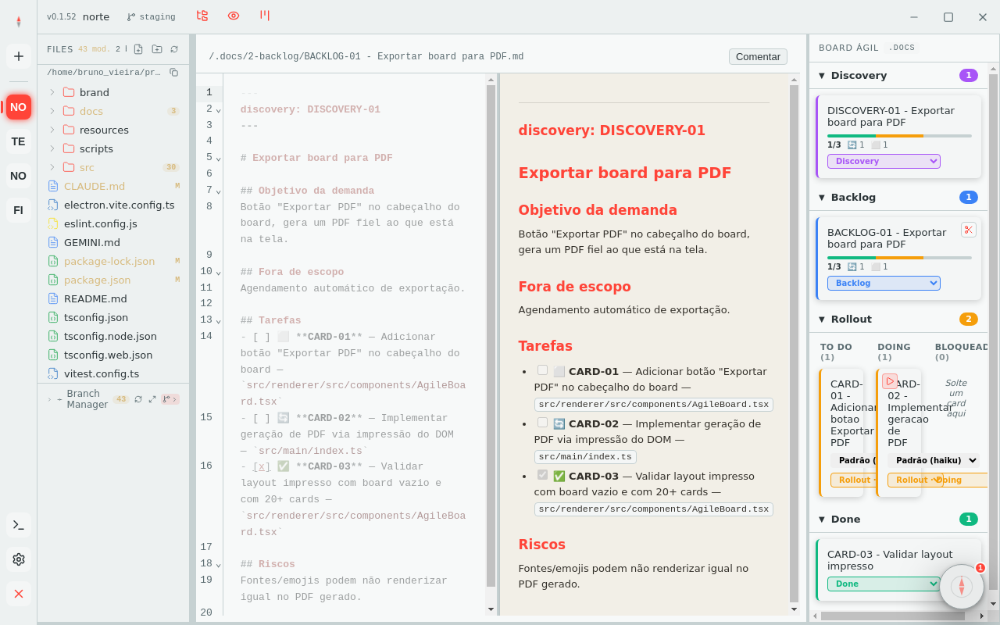
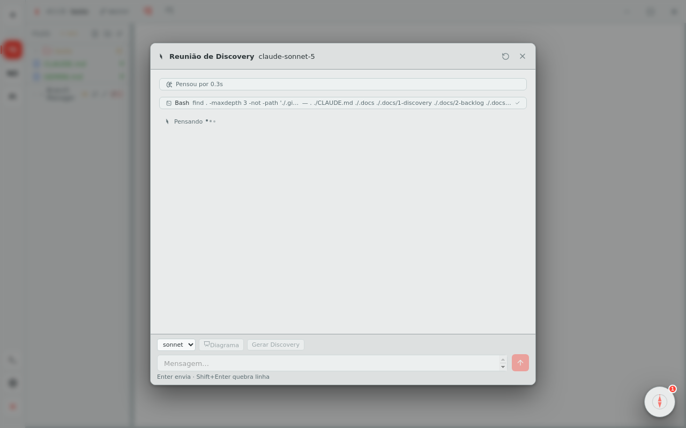

<p align="center">
  
</p>

<h1 align="center">Norte 🧭</h1>

<p align="center">
  <b>A IDE agentic local-first para devs modernos que trabalham com IA.</b><br />
  Editor de verdade, git de primeira classe, chat agêntico com Claude Code — e visão de produto embutida por padrão, com um Agile Board como diferencial, não como categoria à parte.
</p>

<p align="center">
  <a href="../../releases/latest"></a>
  
  <a href="LICENSE"></a>
</p>

---

Este repositório **não tem código-fonte** — é o canal de distribuição dos instaladores prontos do
Norte. Cada [release](../../releases) traz o `.deb` do Linux daquela versão, com as notas do que
mudou.

## Instalação (Linux, `.deb`)

1. Baixe o `.deb` mais recente na [página de Releases](../../releases/latest).
2. Instale:
   ```bash
   sudo dpkg -i norte_*.deb
   ```
3. Se faltar alguma dependência, resolva com:
   ```bash
   sudo apt-get install -f
   ```

Depois de instalado, o Norte abre pelo menu de aplicativos do sistema ou pelo comando `norte`.

## Atualizando

Não há atualização automática por enquanto — repita os passos acima com o `.deb` da versão mais
nova quando uma sair. A [página de Releases](../../releases) é o changelog: cada tag traz as notas
do que mudou desde a anterior.

---

## Screenshots

<p align="center">
  
  <br />
  <sub>Editor Markdown lado a lado com o preview renderizado, board ágil sincronizado com as pastas do disco.</sub>
</p>

<p align="center">
  
  <br />
  <sub>Reunião de Discovery: sessão própria de chat agêntico (Claude Code), conduzida como um PO sênior conduziria.</sub>
</p>

---

## Por que Norte existe

Se você é um dev moderno que trabalha lado a lado com Claude Code, Copilot e Gemini todo dia — com uma visão de produto que vai além de só escrever código —, provavelmente já sentiu isso:

- **Suas regras de projeto vivem em três lugares diferentes** (`CLAUDE.md`, `GEMINI.md`, `.github/copilot-instructions.md`) e ficam dessincronizadas a cada duas semanas.
- **Seu board vive numa SaaS** (Jira, Trello, Linear) enquanto sua documentação técnica vive em Markdown no repo — dois sistemas de verdade, um context-switch a cada card.
- **A IA do seu editor não conhece a persona/regra de negócio que você definiu** — ela responde genérico até você colar o contexto de novo, pela enésima vez.
- **Nenhuma ferramenta confia — de verdade — no que um agente diz que fez.** "Pronto" vira um `git diff` que você precisa achar tempo pra revisar em outro lugar.

Norte parte de uma aposta simples: a IDE mais moderna que dá pra construir hoje não é a que tem o autocomplete mais esperto — é a que trata **produto, board e código como uma coisa só**, e onde a palavra final sobre "terminou" nunca é do agente, é sua (ou do próprio Norte, checando o `git diff` de verdade, nunca o autorrelato de quem executou). Um único app desktop, **100% local**: seus arquivos `.md` continuam sendo a fonte da verdade (versionáveis, legíveis por humanos e por agentes), o Kanban é renderizado direto de pastas no disco, e um Orquestrador de Agentes garante que a mesma persona/regra vale para Claude, Gemini, Copilot **e** para a IA embarcada do próprio Norte.

Sem vendor lock-in. Sem sincronizar nada pra nuvem além da chamada de IA que você mesmo autorizar (BYOK) — com uma única exceção documentada e discreta: a sincronização de conhecimento em inatividade (veja [IA embarcada](#ia-embarcada-embedded-agent-vs-chat-agêntico)), que roda sozinha depois de alguns minutos parado, sempre gravando só no seu disco.

## O Diferencial

**🧭 WYSIWYN** — *What You See Is What You NEED*. O board é a tela padrão, editar código à mão é opcional, e a árvore de arquivos nunca some atrás de um chat. Ver [WYSIWYN](#wysiwyn-what-you-see-is-what-you-need).

**📋 Agile Board Kanban** — cada card é um arquivo `.md` real no seu disco, versionável em git, sem banco de dados externo. Ver [Agile Board](#agile-board).

**🤖 O Companion** — um único ponto na tela pra tudo: erro, aviso, dica, diagnóstico de código, status de git. Nunca um banner solto, nunca uma notificação perdida. Ver [O Companion](#o-companion).

**🌿 Branch Manager** — troca de branch, conflito, push/pull e sugestão de commit por IA, num só lugar, sem sair do fluxo. Ver [Branch Manager](#branch-manager).

**🪄 Orquestrador de Agentes** — CRUD global de "agentes" (nome + prompt de persona/regras), reutilizável entre projetos. Marque um como ativo e ele é injetado simultaneamente em `CLAUDE.md`, `GEMINI.md` e `.github/copilot-instructions.md` do workspace aberto — e passa a guiar também as features da IA embarcada do Norte.

**⚡ IA embarcada + Chat agêntico** — duas IAs com papéis diferentes, nunca confundidas. Ver [IA embarcada](#ia-embarcada-embedded-agent-vs-chat-agêntico).

**🗺️ Diagramas vivos** — preview lado a lado de Mermaid (state machine, sequence, class, ER) enquanto você edita.

**🔍 Busca full-text + backlinks** — índice SQLite (FTS5) derivado dos seus `.md`; os arquivos continuam sendo a única fonte da verdade, o índice é só cache.

**🌐 Multi-root workspace** — vários projetos abertos ao mesmo tempo, navegação estilo LENS entre eles.

## WYSIWYN (What You See Is What You NEED)

Todo IDE agentic hoje resolve o mesmo problema da mesma forma: esconde o editor atrás de um chat. O Norte aposta no oposto — **o Board Ágil é a tela principal, e editar código à mão é opcional, não o caminho padrão.** Três consequências práticas disso, todas de propósito:

1. **Rodar um card é sempre um gesto explícito** (▶) — nunca automático, nunca "porque a IA achou que devia".
2. **Qualquer arquivo abre com um clique só pra preview.** Editar de verdade exige um segundo clique explícito — o padrão é ler, não editar.
3. **A árvore de arquivos nunca sai da tela.** Não existe a troca "esconde o filesystem, confia no chat" que a maioria dos concorrentes faz.

O nome também se aplica em um sentido menor, de interface: **muita coisa que o Norte faz não tem botão nenhum na tela — de propósito.** Boa parte disso nem é invenção do Norte: é convenção que já é implícita em praticamente qualquer IDE de mercado (Ctrl+S salva, Ctrl+F busca, Ctrl+Z desfaz, zoom, copiar/colar) — se todo mundo já sabe o atalho, botão na tela só é ruído. Por cima disso, o Norte tem suas próprias ações que também só existem por atalho ou clique direito (menu do Companion, ações de git na árvore, remover card do board) — de novo, pra manter o visual limpo. **Configurações → Atalhos** tem a lista completa — convenção geral de IDE e atalho específico do Norte, lado a lado.

## Agile Board

Um card no Norte **é um arquivo `.md` real**, guardado em `.agile/` na raiz do seu projeto — sem banco de dados, sem sincronizar com nada. Arrastar um card entre raias literalmente move o arquivo no disco (`git mv`, se o projeto tiver git). Quatro raias:

`1-discovery` → `2-backlog` → `3-doing` (exibida como **Rollout**, com sub-colunas To Do · Doing · Blocked) → `4-done`.

Cada card recém-criado passa por uma validação leve (`Objetivo`, `Arquivos`, `Padrão a seguir`, `Passos`, `Critério de aceite`, `Fora de escopo`) — o que falta é **mostrado**, nunca bloqueia: às vezes um card incompleto é deliberado, mas o custo disso fica visível antes de você aceitar.

O que fecha o laço de verdade é o botão ▶ num card em Doing: ele cria (ou retoma) uma branch `card/<ID>`, roda o agente dentro dela, e — ponto central do design — **quem decide se terminou é o próprio Norte, comparando o `git diff` contra a branch base, nunca o autorrelato do agente.** "Pronto" não é uma frase que a IA diz; é um diff que existe.

## O Companion

A bolha que fica sempre visível no canto da tela **é o único lugar pra onde qualquer notificação do app converge** — erro de ação, aviso de git, dica de uso, resultado de lint/typecheck. Nada disso aparece solto em outro canto da interface.

**Clique esquerdo** abre o painel: lista de observações ativas, cada uma com sua ação (enviar commits pendentes, abrir o board, iniciar reunião, inicializar git, retomar configuração), um botão "perguntar ao agente sobre isso" por observação, "Rodar diagnóstico" (lint + typecheck sob demanda) e acesso ao chat solto.

**Clique direito** abre os lançadores esporádicos: nova Reunião de Discovery, organizar uma pasta existente em cards do board (com IA), importar documentação legada pro formato do board (com IA).

O que o Companion observa, agrupado por tema:

- **Git** — commits sem enviar, branch desatualizada em relação ao remoto, muitos arquivos sem commit, ausência de repositório.
- **Board** — card parado há dias na mesma raia, backlog crescendo demais, projeto ainda sem nenhum Discovery.
- **Qualidade de código** — erros de lint e de typecheck, capturados sob demanda.
- **Onboarding** — configuração inicial pendente, dicas de uso mostradas uma única vez (entre elas, a explicação do próprio WYSIWYN).

Nenhuma dessas mensagens é inventada pela IA — um sensor determinístico decide **quando** existe algo a dizer; a IA embarcada só escreve o texto final em linguagem natural, e o Companion nunca para de funcionar mesmo sem nenhuma chave de IA configurada (cai num texto padrão).

## Branch Manager

O módulo de gestão de git do Norte, aberto pelo ⤢ na faixa de git do explorer. Resolve, numa tela só:

- **Troca de branch com mudança local pendente** — três saídas em vez de uma tela de erro: guardar (stash), commitar antes de trocar, ou descartar arquivo por arquivo.
- **Push/pull com detecção de "quem está à frente"** — mostra local vs. remoto, publica uma branch nova ainda sem remoto, avisa quando está offline.
- **Sugestão de mensagem de commit por IA** (Embedded Agent) — lê o diff do que está staged e sugere a mensagem; você decide se usa.

## IA embarcada (Embedded Agent) vs. Chat Agêntico

O Norte tem **duas IAs com papéis deliberadamente diferentes** — confundir as duas é o erro mais comum de quem chega no produto:

- **Embedded Agent (DeepSeek, BYOK)** — a IA do próprio Norte, embutida no produto. Responde ao usuário final **dentro do app**, nunca edita nada sozinha sem você ver o diff antes. Não exige assinatura de ferramenta de dev nenhuma, só sua própria chave DeepSeek.
- **Chat Agêntico (Claude Code ou GitHub Copilot CLI)** — o agente que **executa ferramentas de verdade**: lê e escreve arquivo, roda comando, cria branch. Exige sua própria assinatura/autenticação da ferramenta escolhida.

O que o Embedded Agent faz hoje, especificamente:

- Autocomplete fantasma (desligado por padrão) e edição inline via Ctrl+K — com preview de diff, você decide se aplica; quando o trecho pertence a um card ativo, a edição já leva em conta o objetivo/padrão daquele card.
- Geração de diagramas Mermaid a partir de uma descrição em texto.
- Sugestão de mensagem de commit (Branch Manager).
- Síntese da mensagem em linguagem natural do Companion.
- Sincronização de conhecimento em inatividade: depois de alguns minutos parado, resume o que foi feito, o que ficou pendente e dicas de revisão técnica num arquivo interno (`.norte/kb.md`) — a única ação do produto que roda sem gesto explícito seu.
- Organizar uma pasta existente em cards do board, e importar documentação legada pro formato do board.
- Revisão de documento a partir dos comentários acumulados (discussão socrática + diff da versão revisada).

**"Fatiar em cards" e "Gerar Backlog" não são o Embedded Agent** — rodam pelo Chat Agêntico (Claude), porque exigem o mesmo raciocínio de execução de ferramentas que roda um card, não uma resposta pontual.

## As pastas essenciais

Duas pastas são essenciais pro Norte funcionar em **qualquer** projeto que você abrir — o app cria
e lê diretamente das duas, sem elas o Agile Board e a continuidade de sessão não existem:

- **`.agile/`** — a raiz do Agile Board. Cada card mora aqui, organizado por raia. Escondida de propósito da árvore de arquivos normal (é o board quem mostra o conteúdo dela, não o explorer).
- **`.norte/`** — memória interna do Norte por workspace: transcrições de chat, configuração local, e o `kb.md` da sincronização de inatividade. É continuidade de sessão, não documentação.

Note o ponto no início dos dois nomes — é o que os torna "internos", escondidos da árvore normal.

## Stack

- **Electron** + React + TypeScript + `react-resizable-panels`
- **SQLite** (`better-sqlite3`, FTS5) — índice derivado; os `.md` são sempre a fonte da verdade
- **Mermaid** — diagramas texto→render
- **Claude Code CLI** ou **GitHub Copilot CLI** — chat agêntico embutido (provider escolhido em Configurações → Code AI)
- **DeepSeek API (BYOK)** — chave cifrada localmente para o Embedded Agent

## Pré-requisitos

O Norte tem duas integrações de IA distintas — uma obrigatória pro diferencial principal (com duas opções de provider), outra opcional:

- **Chat agêntico — obrigatório, escolha um dos dois:**
  - **[Claude Code CLI](https://claude.com/product/claude-code)** — instale e autentique (`claude login`, com uma assinatura Claude Pro/Max, ou uma chave de API Anthropic).
  - **[GitHub Copilot CLI](https://docs.github.com/copilot/how-tos/copilot-cli)** (`npm install -g @github/copilot`) — instale e autentique (`copilot login`, com uma assinatura GitHub Copilot); o Norte guia esse login de dentro do app (Configurações → Code AI → "Entrar com GitHub" ou no wizard de primeiro projeto).

  Escolha o provider em Configurações → Code AI *antes* de tentar a Reunião de Discovery, o chat por card ou a execução de cards — sem um dos dois autenticado, essas telas não funcionam. O Norte só confirma que o binário escolhido existe e responde; ele **não tem visibilidade** sobre login/assinatura, então um comando presente mas não autenticado só vai falhar na hora de enviar a primeira mensagem.
- **DeepSeek API key — opcional, BYOK.** Só necessária pro Embedded Agent (edição inline, diagramas, mensagens de commit, síntese do Companion, sincronização de inatividade, revisão de documento). Configurável em Configurações → Embedded Agent, cifrada localmente (nunca sai da sua máquina).

## Suporte

Achou um bug ou tem uma ideia? Abra uma [issue neste repositório](../../issues).

## Créditos

Criado e mantido por **[Bruno Vieira](https://github.com/vieiraes)**.

## Licença

[MIT](LICENSE) — use, modifique e redistribua livremente, contanto que o aviso de copyright e a licença original sejam mantidos.
