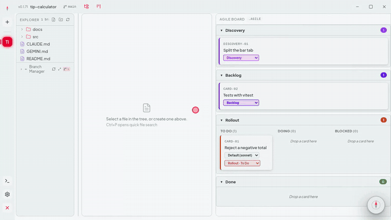
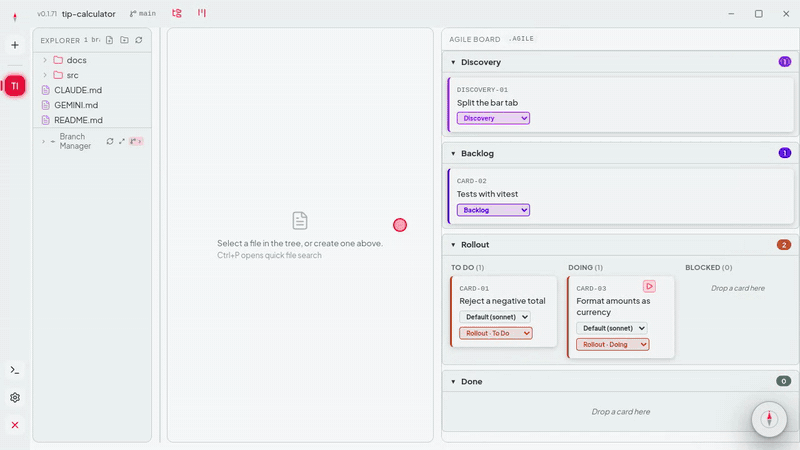
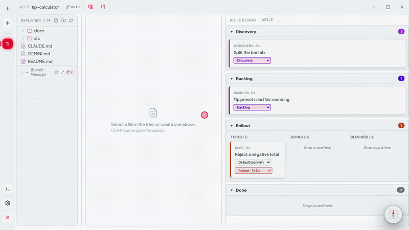

<p align="center">
  
</p>

<h1 align="center">Norte 🧭</h1>

<p align="center">
  <b>A desktop IDE where you don't type code — you move cards.</b><br />
  Write a card, drag it to Doing, press ▶. An AI agent implements it on its own branch,<br />
  and git — not the AI — decides when it's done.
</p>

<p align="center">
  <a href="../../releases/latest"></a>
  
  
</p>

<p align="center"><b>English</b> · <a href="README.pt-BR.md">Português</a></p>

<p align="center">
  
  <br />
  <sub>Real agent, no edits, sped up. <a href="https://github.com/vieiraes/norte-dist/releases/download/v0.1.72/norte-demo-en.mp4">Full video (41 s)</a></sub>
</p>

## Download

**[→ Latest release](../../releases/latest)** — early beta, free for personal use.

| System | File |
|---|---|
| Windows 10/11 (64-bit) | `Norte-Setup-<version>.exe` |
| Linux (Debian, Ubuntu, Mint…) | `norte_<version>_amd64.deb` |
| Linux (any distro) | `Norte-<version>.AppImage` |

**You bring your own agent.** Norte runs the agent CLI already installed and logged in on your machine. It ships no account or key of its own. Pick one:

- [Claude Code](https://claude.com/product/claude-code) — Claude Pro/Max subscription or an Anthropic API key
- [GitHub Copilot CLI](https://docs.github.com/copilot/how-tos/copilot-cli) — GitHub Copilot subscription
- Antigravity (Gemini) — log in once with `agy` in your terminal

Optional: a [DeepSeek](https://platform.deepseek.com) API key powers the small built-in helpers (Ctrl+K inline edit, diagrams, commit messages). Without it, everything else still works.

## What makes it different

**The board is the main screen.** Every card is a real `.md` file in your repo (`.agile/`), and dragging it between lanes moves the file. No database, no SaaS, nothing synced to a cloud.

**Git decides when it's done, not the AI.** ▶ runs the card on its own `card/<ID>` branch. The card only moves to Done when Norte sees a real diff — "done" is never the agent's word.

**The agent is allowed to say "I can't".** If a card is ambiguous or contradicts itself, the Companion stops, writes the question into the card, and the card goes to Blocked instead of a guessed change.

<p align="center">
  
  <br />
  <sub><a href="https://github.com/vieiraes/norte-dist/releases/download/v0.1.72/norte-demo-2-blocked-en.mp4">Full video (46 s)</a></sub>
</p>

**From a backlog to cards a small model can run alone.** "Slice into cards" turns each backlog task into a strict card: exact files, an existing function to imitate, numbered steps, a runnable acceptance check. Vague words ("improve", "as needed", "if possible") get a card rejected before it reaches the agent.

<p align="center">
  
  <br />
  <sub><a href="https://github.com/vieiraes/norte-dist/releases/download/v0.1.72/norte-demo-5-slice-en.mp4">Full video (43 s)</a></sub>
</p>

**It notices things without being asked.** The Companion — the bubble in the corner — flags a card stalled for days, commits you forgot to push, a project without git, and fixes them with one click. [Video (39 s)](https://github.com/vieiraes/norte-dist/releases/download/v0.1.72/norte-demo-4-companion-en.mp4)

**Git without leaving the flow.** Change badges in the file tree, stage → commit → push from the sidebar, a branch graph, and a Branch Manager for local vs. remote and stashed changes. [Video (53 s)](https://github.com/vieiraes/norte-dist/releases/download/v0.1.72/norte-demo-3-git-explorer-en.mp4)

**One set of rules for every AI.** The Orchestrator keeps `CLAUDE.md`, `GEMINI.md` and `.github/copilot-instructions.md` in sync from a single persona, so the agent you switch to tomorrow follows the same rules.

## Install

**Windows** — run `Norte-Setup-<version>.exe`. The installer isn't code-signed yet, so Windows may show "Windows protected your PC": click **More info → Run anyway**.

**Linux (.deb)**

```bash
sudo dpkg -i norte_*.deb
sudo apt-get install -f   # only if a dependency is missing
```

**Linux (AppImage)**

```bash
chmod +x Norte-*.AppImage
./Norte-*.AppImage
```

## Updates

- **Linux (.deb and AppImage):** automatic. Norte downloads the new version in the background and tells you in the Companion. The AppImage applies it on restart; on the .deb, click **Restart and update** and your system asks for your password. **Settings → Companion** has "Check for updates now" and an off switch.
- **Windows:** Norte tells you when a new version is out; download it and run the new installer over the old one.

Each [release](../../releases) lists what changed.

## Privacy

Norte is local-first. Your files never leave your machine except in the AI calls you make, sent by your own agent CLI or your own DeepSeek key. The one thing that runs on its own — a knowledge summary after a few idle minutes — is **off by default** and writes only to your disk.

## Feedback

Norte is in early beta and I'm looking for people to try it on a real project. Something broke, confused you, or worked better than expected? **[Open a beta feedback issue](../../issues/new?template=beta-feedback.md)** — every report gets read.

## About

This repository has no source code: it's the distribution channel for Norte's installers. Built and maintained by **[Bruno Vieira](https://github.com/vieiraes)**.

Proprietary software — see [LICENSE](LICENSE). The binaries are free for personal use; the source code is not open source.
